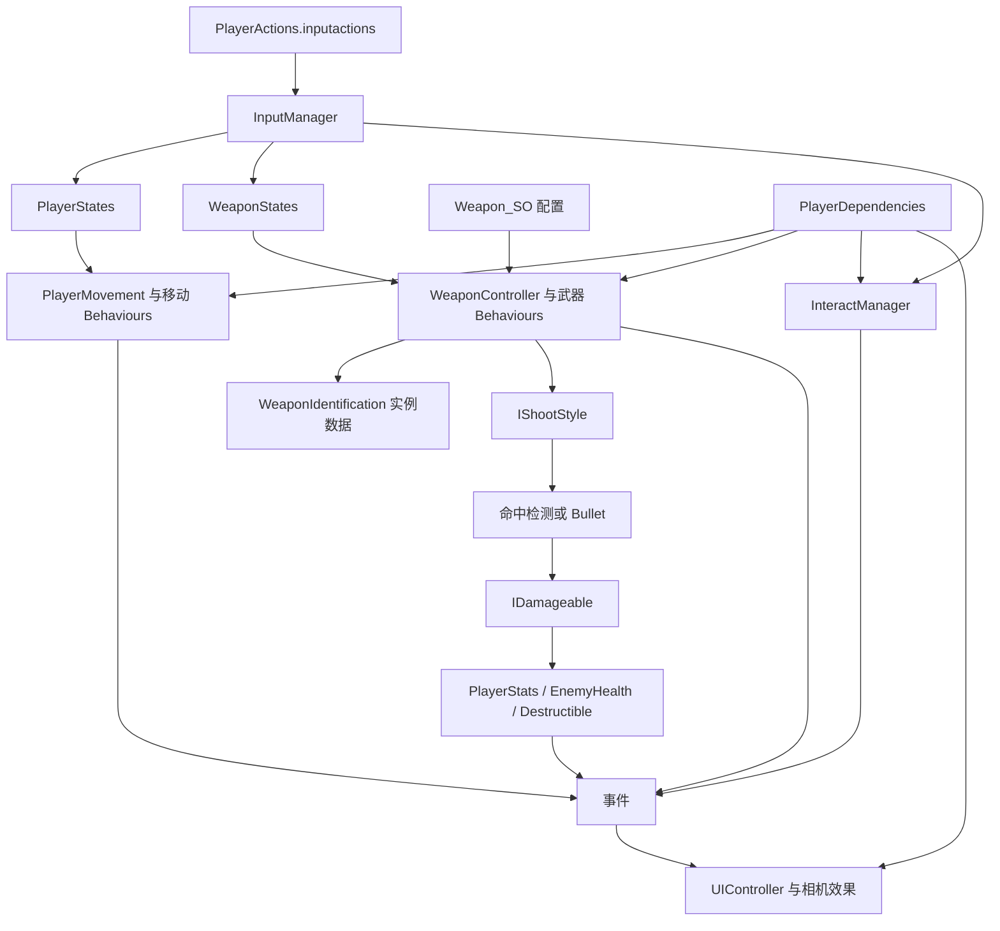

# FPS Engine 开发指南

以本工程实际导入的 **1.4.17 源码和资产**为准。发布者在线文档会继续更新，不能据此假定本地已有新版功能。

## 1. 工程基线与阅读范围

| 项目 | 当前值 |
| --- | --- |
| 工程目录 | `E:\Unity_repo\games\FPS-2026NGJ` |
| 编辑器 | `6000.3.28f1`，revision `8f082d2fe476` |
| FPS Engine | `1.4.17`，由多个资源 `.meta` 的 `assetOrigin.packageVersion` 确认 |
| 渲染管线 | URP `17.3.0` |
| 输入系统 | Input System `1.20.1` |
| 编辑器连接 | Unity CLI `1.0.0-beta.17`，Pipeline `1.0.0-pre.1` |
| UI | uGUI `2.0.0`，包含 TMP；TMP Essentials 已导入 |
| AI Navigation | `2.0.16` 已安装；不代表 FPS Engine 已附带完整敌人 AI |
| 网络 | 未安装实际使用的网络框架；Multiplayer Center 不是已经完成的联机系统 |
| 代码规模 | 188 个 `.cs` 文件、23,890 行，包含编辑器与 2,407 行自动生成输入代码 |
| 资源 | 127 个 prefab、4 个资源包演示场景、8 个武器配置 |

本指南覆盖角色、武器、伤害、交互、管理器、UI 初始化和扩展方式。脚本文件、类型和公开声明见[源码索引](源码索引.md)。

## 2. 资源导航

| 位置 | 用途 |
| --- | --- |
| `Assets/FPS Engine/Demo/BlankScene.unity` | 最小演示起点：玩家、地面、手枪拾取物、事件系统等 |
| `Assets/FPS Engine/Demo/Showroom.unity` | 综合功能展示，适合查找现成用法 |
| `Assets/FPS Engine/Demo/MovementShowroom.unity` | 移动能力展示 |
| `Assets/FPS Engine/Demo/MainMenu.unity` | 主菜单与设置示例 |
| `Prefabs/PlayerControllers/CowsinsFPSController.prefab` | 完整玩家模板，含角色、相机、UI 与辅助对象 |
| `Prefabs/PlayerControllers/MovementCowsinsFPSController.prefab` | 另一个移动展示用玩家模板；使用前核对其完整依赖 |
| `Prefabs/Weapons` | 第一人称持枪实例和空白武器模板 |
| `ScriptableObjects/Weapons` | 武器定义数据 |
| `Prefabs/GraphicsExtra` | 地面拾取物的武器、附件外观 |
| `Prefabs/DragAndDropExtras` | 武器拾取物、门、补给、爆炸物、占点、炮塔等 |
| `Prefabs/Others/UI/PlayerUI.prefab` | HUD 模板 |
| `Resources` | 动态加载的交互 UI、指南针、输入等资源；其中一些名称直接写在代码中 |
| `Animations/Weapons/BlankWeaponAnimatorTemplate.controller` | 本地实际存在的武器 Animator 模板 |
| `Scripts/Editor/Experimental` | Cowsins Manager、武器创建助手等编辑器工具 |

以上简写路径均相对于 `Assets/FPS Engine`。武器名称、配置与 prefab 分工见第 6 节；具体源码位置见[源码索引](源码索引.md)。

不要把 `MovementShowroom`、武器名称、演示按钮或 `CheckPointView` 的名字直接当作已完成的正式游戏规则。

## 3. 总体架构与初始化

### PlayerDependencies 是连接入口

[PlayerDependencies.cs](../Assets/FPS%20Engine/Scripts/Player/PlayerDependencies.cs) 在 `Awake` 从同一个玩家对象收集接口，向输入、相机、UI 和效果组件注入依赖。它负责连接，不负责具体移动或射击。

主要接口分为移动状态/事件、武器引用/行为/后坐力/事件、玩家数值/事件、交互/事件、控制权与数值乘数。替换组件时必须满足这些接口；只删除一个看似不用的组件，可能导致其他模块初始化失败。

完整玩家 prefab 的外层 `CowsinsFPSController` 是容器，实际带 Rigidbody、CapsuleCollider、PlayerMovement 等组件的是其内部 `Player` 对象。相机和 HUD 也有序列化引用，不能只复制这个内部对象就假定模板完整。

### 两套独立状态机

角色状态由 `PlayerStates` 驱动；武器状态由 `WeaponStates` 驱动。两者通过依赖接口、输入和事件协作，不能仅靠修改 Animator 让玩法状态同步改变。

| 系统 | 状态 |
| --- | --- |
| 角色 | Default、Jump、Crouch、Dash、Climb、Dead |
| 武器 | Default、Shooting、Reload、Melee、Inspect、Unholster、Hidden |

WallRun、WallBounce、Grapple 等主要是行为与标志，未各自对应一个同名角色状态。角色与武器工厂缓存大部分状态对象；Dash 根据当次输入新建。

`ForceChangeState(...)` 会执行退出和进入流程。新玩法若改变控制、武器或动作状态，应保持这些流程和事件一致，避免只改一个布尔值。

## 4. 移动、视角与控制权

本包使用 **Rigidbody + CapsuleCollider**，不是 Unity CharacterController。初始化时配置冻结旋转、连续动态碰撞与插值；代码已使用 Unity 6 的 `linearVelocity` 和 `linearDamping`。

[PlayerMovement.cs](../Assets/FPS%20Engine/Scripts/Movement/PlayerMovement.cs) 创建 `MovementContext` 和各行为对象；多数行为是普通 C# 类，由状态机调用，不是独立挂载的 MonoBehaviour。

| 行为 | 职责与配置位置 |
| --- | --- |
| BasicMovementBehaviour | 朝向相关移动、空中控制、斜坡投影、水平限速、摩擦、重量乘数 |
| GroundDetectionBehaviour | CapsuleCast 与备用射线检测、落地事件、跳跃期间的地面忽略窗口 |
| VelocityHandlerBehaviour | 在走、跑、蹲、瞄准和耐力状态之间调整 CurrentSpeed 与 FOV |
| JumpBehaviour | 多段跳、跳跃冷却、方向跳、落下高度重置、土狼时间相关逻辑 |
| CrouchSlideBehaviour | 缩放玩家实现下蹲、头顶检测、滑行推进、转向与结束条件 |
| DashBehaviour | 前向/输入方向/自由视角冲刺，次数与恢复冷却 |
| WallRunBehaviour / WallBounceBehaviour | 侧墙检测、墙跑、墙跳、墙面反弹 |
| ClimbLadderBehaviour | `Ladder` 层检测；W/S、视角、混合三种爬梯方式 |
| GrapplingHookBehaviour | SpringJoint 与 LineRenderer；Linear、Swing、Combined 三种配置 |
| CameraLookBehaviour | 俯仰限制、瞄准灵敏度、倾斜、辅助瞄准、PlayerOrientation 更新 |
| StaminaBehaviour | 跑、跳、滑行、冲刺的消耗与恢复，耐力 UI |
| FootstepsBehaviour | 根据命中表面层选择脚步音效 |
| SpeedLinesBehaviour | 速度线显示与强度 |

主配置为 [PlayerMovementSettings.cs](../Assets/FPS%20Engine/Scripts/Movement/PlayerMovementSettings.cs)，序列化在 `PlayerMovement.playerSettings` 中。优先调整功能开关和参数，保留整体依赖结构。

需要特别注意：

- 当前模板同时启用了多项高级移动能力；正式 demo 应按玩法选择启用项，关卡尺度也要一起确定。
- 角色朝向由 `PlayerOrientation` 提供，视角变化不等于直接旋转整个刚体根对象。
- `PlayerControl` 区分全局控制权和移动控制权。对话、菜单、结算等可使用 `LoseControl()`、`CheckIfCanGrantControl()`；恢复前需要考虑暂停和死亡状态。
- 地面、可墙跑表面、梯子使用 Layer/LayerMask，当前层表见第 11 节。
- 土狼时间的配置传递仍需单独验证，不能仅因 Inspector 有开关就视为实测有效。

## 5. 输入系统与默认操作

源文件是 [PlayerActions.inputactions](../Assets/FPS%20Engine/Inputs/PlayerActions.inputactions)。`Inputs/PlayerActions.cs` 是自动生成包装，不应作为长期手工修改入口。

`InputManager` 将 Input Actions 转成状态值和 Action 事件，处理按住/切换模式、鼠标与手柄视角、交互重绑，并通过 PlayerPrefs 保存绑定覆盖。

| 动作 | 默认键鼠 |
| --- | --- |
| 移动 / 视角 | WASD / 鼠标 |
| 跳跃 / 奔跑 / 下蹲 | Space / Left Shift / Left Ctrl |
| 射击 / 瞄准 / 换弹 | 鼠标左键 / 右键 / R |
| 冲刺 / 抓钩 | 鼠标中键 / C |
| 交互 / 丢弃 | E / G |
| 快速近战 / 检视 / 手电 | F / I / T |
| 切枪 | 鼠标滚轮；数字键由武器控制器设置控制 |
| 暂停 | Escape |
| 背包 / 快捷菜单 / 提示 | Tab / Q / Q；实际响应取决于相关组件和附加包 |

有按键定义不代表基础包已提供完整背包系统。Q 同时绑定 `InventoryFavOpen` 与 `ToggleTipsCanvas`，自定义时应检查重复用途。

局域网改造时，InputManager 的静态 `inputActions`、全局当前输入设备和各回调只能驱动本机拥有的玩家，不能给远端玩家照搬整套本地输入。

## 6. 武器：定义、实例与策略

### 数据分层

- [Weapon_SO](../Assets/FPS%20Engine/Scripts/Weapons/Weapon_SO.cs)：共享定义。包含射击策略、输入方式、伤害、弹匣、换弹、后坐力、散布、ADS、音效、特效与第一人称 prefab 引用。
- [WeaponIdentification](../Assets/FPS%20Engine/Scripts/Weapons/WeaponIdentification.cs)：具体持枪实例。保存当前弹药、备用弹药、热量、附件、有效数值、Animator、FirePoint 与 AimPoint。
- [WeaponControllerSettings](../Assets/FPS%20Engine/Scripts/Weapons/WeaponControllerSettings.cs)：玩家武器系统配置。包含槽位数、初始武器、命中层、自动换弹、快速近战、切枪方式和自定义射击事件表。

运行中改变某把枪的弹药或附件效果，应操作实例数据。改共享 Weapon_SO 会影响引用它的其他实例，联机时尤其需要稳定的武器定义 ID 和独立实例状态。

### 射击流程

`WeaponStates → ShootBehaviour → WeaponIdentification.Shoot → IShootStyle → 命中/弹丸 → IDamageable`。

| ShootStyle | 本地实现 |
| --- | --- |
| Hitscan | 摄像机射线、散布、穿透、命中事件与弹道轨迹 |
| Projectile | 生成 Bullet，传入速度、伤害、目标点、爆炸等数据 |
| Melee | 近身范围检测、攻击延迟、动画与命中反馈 |
| Custom | 根据当前 Weapon_SO 查找 `settings.customPrimaryShot`，执行对应 UnityEvent |

`ShootingMethod` 有 Press、PressAndHold、HoldAndRelease、HoldUntilReady。`fireRate` 在主要枪械配置中表示**两次射击之间的时间间隔**，不是“每秒发射几发”。霰弹/连发还涉及 `bulletsPerFire` 和 `timeBetweenShots`。

`ReloadBehaviour` 支持普通弹匣和过热冷却；`limitedMagazines` 控制备用弹药是否有限。当前 8 个示例武器均关闭有限备用弹药，所以手枪换弹后备用数字不下降是示例配置结果。

后坐力、散布、ADS、重量、枪口/弹孔/弹壳效果由各自 Behaviour/System 处理。相机震动、FOV、HUD 等依赖事件，不应在自定义开火中只扣血而遗漏其他反馈。

### 现有武器

| 配置 | 类型 | 弹匣 | 定义伤害 | 射击间隔 |
| --- | --- | --- | --- | --- |
| Pistol | Hitscan | 17 | 2 | 0.35s |
| Revolver | Hitscan | 6 | 5 | 0.4s |
| Rifle | Hitscan | 30 | 2.8 | 0.2s |
| BurstRifle | Hitscan | 15 | 3 | 0.8s |
| SMG，显示名 MP5 | Hitscan | 36 | 1.5 | 0.12s |
| Shotgun | Hitscan | 4 | 5/弹丸，需结合发射数量 | 1.2s |
| RocketLauncher | Projectile | 1 | 20，爆炸另按距离计算 | 0.35s |
| Katana | Melee | 非近战核心参数 | 近战伤害 20 | 近战另看 attackRate |

以上为当前资产的定义值，不含附件和运行时乘数，不能直接当最终平衡方案。

### 新武器制作入口

编辑器菜单：`Cowsins/Create/Weapon ( Weapon Creation Assistant )`；也可使用 `Create → COWSINS → New Weapon`。

建议从现有同类型武器复制配置和 prefab，再替换外观及参数：

1. 保存新的 Weapon_SO。
2. 准备第一人称 prefab：武器与手臂模型、Animator、WeaponIdentification、WeaponSpecificEffects。
3. 指定枪口 `FirePoint[]`、瞄准 `aimPoint`，需要时配置 `HeadBone`。
4. 在实例组件和 Weapon_SO 之间建立正确的双向资源引用。
5. 配置地面 `pickUpGraphics` 与 UI icon；第一人称模型和拾取物模型用途不同。
6. 沿用本地 Animator 模板的参数及状态约定，检查 shooting、reloading、Unholster、行走/奔跑/检视流程。
7. 用 `InstantiateWeapon(...)`、初始武器列表或 WeaponPickeable 接入正常的装备流程，再验证射击、ADS、换弹、切枪与丢弃。

资源目录为 `Assets/FPS Engine`。部分原厂编辑器工具仍硬编码 `Assets/Cowsins/...`；使用创建助手前需要适配其路径。复制现有武器配置和 prefab 的工作流不受该工具路径影响。

Katana 的 `NewKatanaAnimatorController` 中，`reloading → Idle` 过渡缺少 Exit Time 和条件，Unity 会忽略该过渡；使用该武器时需要补充过渡条件。

## 7. 背包、附件与拾取

`WeaponInventorySystem` 管理的是**武器槽位**。主要入口有 `InstantiateWeapon`、`SelectWeapon`、`TryToAddWeapons`、`SwapWeapons`、`ReleaseWeapon`。完整物品网格背包属于另一个附加包。

附件分 Barrel、Scope、Stock、Grip、Magazine、Flashlight、Laser。`AttachmentIdentifier_SO` 表示定义；武器 prefab 中的 Attachment 表示实例与外观。兼容列表和默认附件都位于武器实例配置中。

`Attachment.Attach/Dettach` 修改 WeaponIdentification 的数值；Magazine 还改容量，Barrel 可改音效和枪口特效，Scope 影响瞄准位置。拾取物保存弹药与附件状态；交换和丢弃并不是简单 Destroy/Instantiate 一个模型。

## 8. 伤害、敌人、死亡与恢复

伤害共同入口为 [IDamageable.cs](../Assets/FPS%20Engine/Scripts/Enemies/IDamageable.cs)：`Damage(float damage, bool isHeadshot)`。

- `PlayerStats`：护盾先吸收，再扣血；自动恢复、治疗倍率、坠落伤害、死亡通知、重生接口。
- `EnemyHealth`：敌人生命/护盾、受伤/死亡事件、伤害飘字、击杀 UI 与销毁行为。
- `Destructible`：可破坏物体、战利品、被破坏后的派生逻辑。

Hitscan 命中 `Critical` 或 `BodyShot` 标签时，会向父级寻找 IDamageable；普通命中直接查询命中 Collider 所在对象。因此，自制敌人的子碰撞体标签、层和父级伤害接口必须一起配置。Projectile、Melee、爆炸各有独立伤害路径，需要分别验证。

`EnemyHealth` 主要提供受伤和死亡，不是完整寻路/战斗 AI。`Turret` 有范围、视线、瞄准与弹丸功能；TrainingTarget、CircularTargetEnemy 是靶标示例。本工程没有搜索到已接入的 NavMeshAgent 敌人逻辑或网络化敌人控制器。

`PlayerStats.Respawn(position)` 会恢复数值并发出移动重生事件；`PlayerMovement.TeleportPlayer(...)` 重置位置、部分动作资源和状态。正式复活仍需要验证控制权、相机、刚体与武器状态。`CheckPointView` 只显示到目标的距离，不是完整检查点存档系统。

## 9. 交互、道具与场景机制

`InteractManager` 从主相机发射交互射线，管理高亮、禁止交互、按住进度、间隔、丢弃和检视 UI。

扩展普通交互物可派生 `Interactable`，重写 `Interact(Transform player)`、`IsForbiddenInteraction(...)`、`Highlight()`、`Unhighlight()`。需要基础事件时保留相应 base 调用。对象须有 Collider，并处于实际交互掩码覆盖的层。

| 机制 | 实现 |
| --- | --- |
| 武器/弹药/附件拾取 | WeaponPickeable / BulletsPickeable / AttachmentPickeable |
| 门 | DoorInteractable，开闭、锁定、位置与旋转动画 |
| 补给 | Trigger → PowerUp → Healthpack / DamageMultiplier / HealMultiplierPowerUp |
| 爆炸/破坏物 | Destructible、ExplosiveBarrel、Crate |
| 货币/经验 | Coin、Experience 与对应单例管理器 |
| 占点 | PointCapture，触发范围内推进、可配置离开后回退、完成事件 |
| 跳板/伤害区 | JumpPad / HurtTrigger |
| 战利品箱 | Lootbox，与货币和物品生成关联 |
| 自定义枪示例 | GravitonWeapon，与 Custom ShootStyle 的事件接入方式相关 |

这些组件是可用的玩法基础，需要根据 Game Jam 规则定义胜负、波次、目标、结算和重开流程。

## 10. UI、相机、效果与全局管理器

`UIController.Initialize(PlayerDependencies)` 订阅移动、武器、交互、数值事件，更新生命/护盾、弹药、武器栏、交互提示、附件检视、冲刺、货币、经验、命中、伤害飘字与击杀信息。

除实例事件外还有静态 `UIEvents`，例如 `onEnemyHit`、`onEnemyKilled`、`onCoinsChange`。它们适合当前单人模板，但缺少玩家归属和攻击者标识，不能直接当联机消息使用。

| 系统 | 责任 |
| --- | --- |
| CameraFOVManager | 正常、奔跑、墙跑、ADS 和开火时的 FOV |
| CameraEffects / CameraAnimations | 震动、落地/爆炸反馈、动画姿态跟随 |
| WeaponEffects / WeaponSpecificEffects | 持枪摇摆、呼吸、倾斜、跳跃动作与武器特有效果 |
| ProceduralShot / ProceduralShot_SO | 程序化射击姿态曲线 |
| PoolManager | 按 prefab 建池、取出、扩容与归还；效果和伤害飘字大量使用 |
| SoundManager | 2D 与空间音效；空间 AudioSource 经对象池使用 |
| GameSettingsManager | 分辨率、画质、帧率、音量、灵敏度与 PlayerPrefs，跨场景保留 |
| PauseMenu | 菜单、控制权和鼠标锁定；当前实现没有直接设置 Time.timeScale |
| MainMenuManager | CanvasGroup 分页与按场景索引加载 |
| AddonManager | 根据编译宏报告额外包是否存在；它本身不提供附加包功能 |

更换 HUD 时须保留引用和初始化事件连接。建立新场景时先复制完整工作模板，再逐步调整；不能因不需要金币显示就随意删除 UI 初始化仍依赖的管理器。

## 11. 层配置与 URP 使用约定

对象、LayerMask、表面音效/命中特效缓存以及武器预设使用下表中的层编号。新增内容按名称选层或使用 `LayerMask.GetMask(...)`，避免硬编码数字编号。

| 层 | 编号 | 用途 |
| --- | --- | --- |
| Ground | 8 | 普通地面、墙体 |
| Weapons | 9 | 第一人称武器与手臂 |
| Enemy | 10 | 敌人及受击碰撞体 |
| Object | 11 | 普通物理物体 |
| Interactable | 12 | 武器、弹药、附件拾取及交互碰撞体 |
| Grass / Metal / Mud / Wood | 13 / 14 / 15 / 16 | 对应表面音效和命中特效 |
| UITop | 17 | 武器相机绘制的置顶内容 |
| PostProcessing | 18 | URP Volume 对象 |
| Effects | 19 | 特效 |
| Player | 20 | 玩家刚体与碰撞体 |
| Ladder | 21 | 梯子检测 |
| WorldUI | 22 | 检查点距离等世界空间 UI |

玩家对象使用 Player 层，地面检测掩码包含 Ground 层。新增表面类型时，确保 `layerName` 与缓存层编号一致，武器预设中的表面配置也应使用同一套层表。

### 相机

- Main Camera：唯一带 `MainCamera` 标签的主相机，Base 类型，启用 HDR 和后处理。遮罩排除第一人称 Weapons、UI 与 UITop，其余世界内容正常绘制。
- WeaponCamera：Untagged、Overlay，主相机栈中引用一次，绘制 Weapons、UI、UITop；关闭自身后处理，让第一人称武器保持清晰。
- 完整玩家 prefab、移动变体和四个演示场景使用上述 URP 相机配置；每台相机只保留一个 UniversalAdditionalCameraData。

### 后处理

项目配置保存在 `Assets/Game/Settings/Rendering`：

| 配置 | 使用场景 | 主要设置 |
| --- | --- | --- |
| `FPSGameplayVolume.asset` | BlankScene、Showroom、MovementShowroom | Bloom 0.03、曝光 0.5，以及颗粒、色差、暗角、景深等参数 |
| `FPSMenuVolume.asset` | MainMenu | Bloom 0.03、曝光 0.2，以及菜单色彩与景深配置 |

各场景的 PostProcessing 对象使用原生全局 Volume，权重为 1，位于 PostProcessing 层，主相机 Volume Mask 覆盖该层。

PC Renderer 使用原生 SSAO。美术调色以 URP 的实际画面为准。

### 材质与着色器

`Assets/FPS Engine/Shaders/WorldSpace.shader` 中的 `Unlit/WorldSpace` 用于世界坐标网格投影，通过 `_UVs` 控制缩放，支持 URP 光照、阴影、深度和法线通道。

MovementShowroom 的默认方块使用 `Assets/Game/Materials/DefaultLit.mat`，灰尘和经验粒子使用同目录的 `DefaultParticles.mat`，速度线使用 URP Particles Unlit，金币背景 Sprite 使用 URP Sprite Unlit。

粉色材质首先检查实际 Shader。[URP 不支持 Surface Shader](https://docs.unity3d.com/cn/6000.0/Manual/render-pipelines-feature-comparison.html)，这类自定义着色器需要单独适配，不能仅依赖整包转换器。包内其他 Legacy 粒子和自定义 UIBlur Shader 在使用前需确认 URP 兼容性。

## 12. 局域网多人改造边界

本地源码没有 NetworkBehaviour、NetworkIdentity、NetworkObject 或对应 RPC 的实现，包的基础架构仍然是单机。

如果决定做 LAN，先验证 2 人最小闭环：建房/加入 → 各自控制自己的玩家 → 看见对方 → 伤害/死亡/重生一致 → 拾取物只被取得一次。

需要明确处理：

1. 本地玩家的输入、摄像机、第一人称模型、HUD 与远端第三人称表现分离。
2. 选定主机/服务端负责的伤害、生命、弹药、物品归属和比赛规则；把客户端动作请求与最终结果分开。
3. 同步武器选择、射击表现、重装、附件、投射物和交互状态，不把普通 UnityEvent 当成网络广播。
4. 为伤害补充攻击者/所属玩家信息。当前 IDamageable 只有数值和爆头标记，不足以独立完成联机击杀归属。
5. 避免全局 UIEvents、Camera.main、FindWithTag("Player")、静态输入和各类单例误引用远端玩家。
6. 使用稳定的武器/物品标识传递定义，实例弹药与附件状态由各个网络对象持有。

发布者已有基于 Mirror、列出 LAN 支持的独立 Multiplayer Add-On，但与本地 **1.4.17** 的最低版本依赖尚未确认。采用前先核对，再决定是否升级基础包；当前没有安装或切换网络框架。

## 13. 后续开发的落点

| 需求 | 优先入口 |
| --- | --- |
| 调整跑跳和能力组合 | PlayerMovement.playerSettings 与对应 Behaviour |
| 新武器/数值 | 新 Weapon_SO、武器 prefab、Animator、拾取物 |
| 非常规枪械效果 | Custom ShootStyle 事件表；复杂实现再考虑自己的 IShootStyle 接入 |
| 门、终端、任务装置 | Interactable 派生类或 OnInteract 事件 |
| 任务区域/占点 | Trigger / PointCapture 与独立的任务管理器 |
| 自制敌人 | 敌人 AI 自行实现，接 IDamageable 或 EnemyHealth |
| 奖励、被动和临时增益 | PowerUp、PlayerMultipliers、角色/武器事件 |
| 生命/弹药/UI 重做 | 实例事件与 UIController 适配，保留依赖初始化 |
| 死亡/结算/重开 | PlayerStats 事件、控制权、场景与游戏流程管理器 |
| 局域网 | 在确认网络方案后建立独立适配层和远端角色表现 |

项目自己的内容建议存入 `Assets/Game`，从完整玩家 prefab 派生 variant，从武器配置复制出项目资产。团队统一 Unity 版本、URP 素材要求与 Animator 命名，场景和大型 prefab 指定负责人以减少同时编辑冲突。

## 14. 参考资料

源码入口见[源码索引](源码索引.md)。在线文档供流程参考，具体 API 与路径以本地 1.4.17 为准：

- [发布者安装指南](https://cowsinss-organization.gitbook.io/fps-engine-documentation/getting-started/01.-basic-set-up)
- [新增武器指南](https://cowsinss-organization.gitbook.io/fps-engine-documentation/how-to-use/adding-new-weapons)
- [多人扩展](https://marketplace.unity.com/packages/templates/systems/multiplayer-add-on-for-fps-engine-414072)
